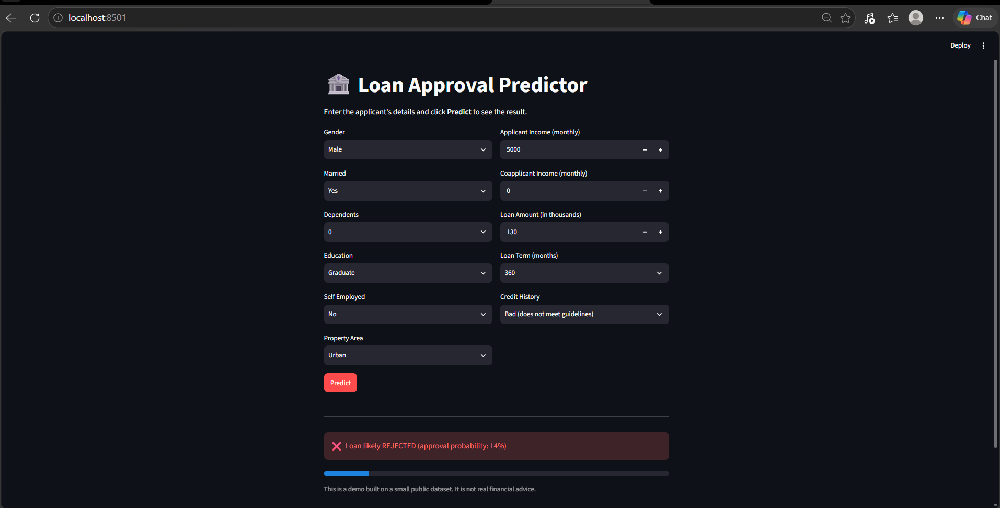

# 🏦 Loan Approval Predictor
https://loan-predictor-bbkfwfupbrmpky2tuyjekr.streamlit.app/

A machine learning web app that predicts whether a loan application is likely to be approved, based on applicant details such as income, credit history, loan amount and property area.



## Problem

Banks review many loan applications and need a fast, consistent first-pass decision. This project trains a classification model on historical loan data and serves it through a simple web app where a user can enter an applicant's details and instantly see the predicted outcome and approval probability.

## Dataset

[Loan Prediction Problem Dataset](https://www.kaggle.com/datasets/altruistdelhite04/loan-prediction-problem-dataset) from Kaggle: 614 applicants with 12 features (gender, marital status, dependents, education, self-employment, applicant and coapplicant income, loan amount, loan term, credit history, property area) and the loan status (approved or not).

## Approach

1. **Data exploration:** checked missing values, class balance, and how credit history and education relate to approval.
2. **Data cleaning:** filled missing categorical values with the mode and missing loan amounts with the median; dropped the ID column.
3. **Encoding:** converted categorical columns to numeric with one-hot encoding.
4. **Modeling:** trained and compared three models on an 80/20 stratified split.
5. **Model selection:** chose the model with the best F1 score and saved it with `joblib`.
6. **App:** built a Streamlit interface that loads the saved model and returns a prediction with a probability.

## Results

| Model | Accuracy | Precision | Recall | F1 |
|---|---|---|---|---|
| **Logistic Regression** | **0.854** | 0.838 | 0.976 | **0.902** |
| Random Forest | 0.837 | 0.857 | 0.918 | 0.886 |
| Gradient Boosting | 0.821 | 0.825 | 0.941 | 0.879 |

Logistic Regression performed best on F1, and it is also the easiest to interpret, so it was chosen as the final model. Credit history is the strongest factor in the dataset.

## Tech stack

Python, pandas, scikit-learn, matplotlib, seaborn, Streamlit, joblib

## Project structure

```
loan-predictor/
├── data/             # dataset (train.csv)
├── models/           # saved model and column list
├── reports/          # charts and model comparison table
├── images/           # app screenshot
├── train.py          # data cleaning, training, model comparison
├── app.py            # Streamlit web app
└── README.md
```

## How to run

```bash
# 1. Clone the repo
git clone https://github.com/vaishnavisnb/loan-predictor.git
cd loan-predictor

# 2. Create and activate a virtual environment
python -m venv venv
venv\Scripts\activate          # Windows
# source venv/bin/activate     # Mac/Linux

# 3. Install dependencies
python -m pip install pandas scikit-learn matplotlib seaborn joblib streamlit

# 4. Train the model
python train.py

# 5. Launch the app
python -m streamlit run app.py
```

## Limitations and next steps

- The dataset is small (614 rows), so results may not generalize to real lending decisions.
- This is a learning project and should not be used for actual financial decisions.
- Planned improvements: add SHAP explanations to show why each prediction was made, scale the features, tune hyperparameters, and deploy the app online.

## Author

Vaishnavi · [GitHub](https://github.com/vaishnavisnb)
